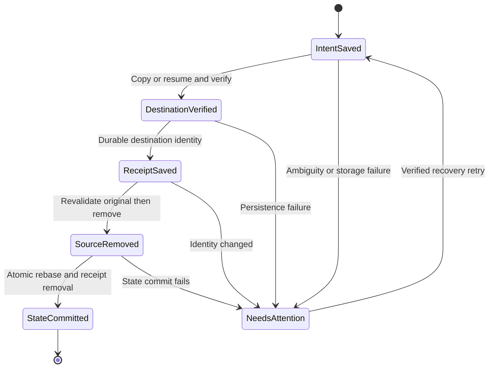
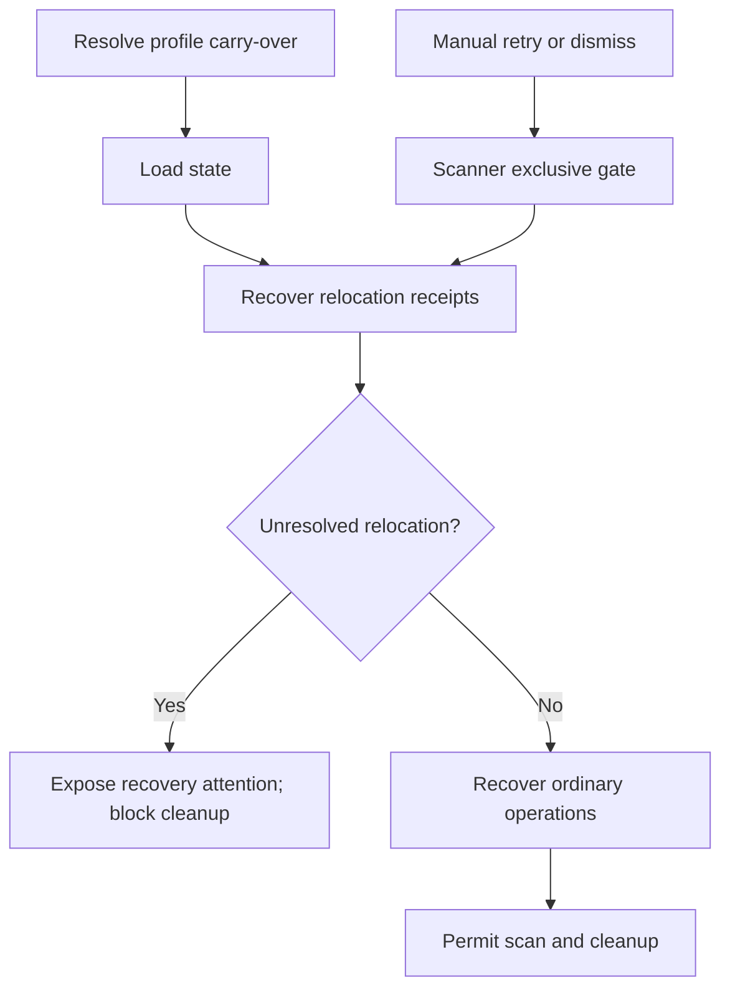
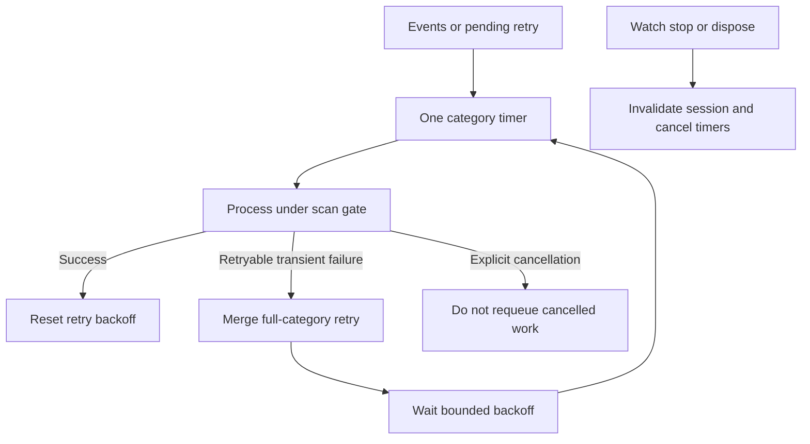

# Final Audit Remediation - Plan

## Goal Capsule

- **Objective:** Keep protected images safe and make interrupted sorting work recoverable without stranding reviews or silently abandoning an existing profile.
- **Means:** Durable relocation receipts, exclusive recovery actions, safe missing-review dismissal, retryable profile migration, and bounded watcher retries.
- **Authority:** Planning only. Implementation, tests, packaging, release, commit, push, and publication require a separate execution request.
- **Execution profile:** Preserve the current dirty working tree on `feat/scan-removal-filters`. Add regression coverage before changing each failing behavior. Use isolated fixture images and profiles.
- **Stop conditions:** Stop affected destructive operations when identity, storage availability, journal ownership, or durable state cannot be established. Report evidence instead of treating uncertainty as absence.
- **Completion owner:** A later implementer completes U1-U7 and supplies the Verification Contract evidence; this document does not claim those checks have run.

---

## Product Contract

### Summary

Repair the five validated findings from the final whole-app audit while preserving the existing scan, filtering, archive and recoverable-removal behavior.

### Problem Frame

The audited tree passed 600 regression tests, but four controlled probes exposed failure paths outside that coverage. Archive relocation can lose Keep protection after a persistence interruption. Recovery can remove another operation's active journal. An externally removed filter image can strand its review. A temporary legacy-profile move failure can hide the old profile behind a fresh one. Source inspection also showed OnDetection watcher failures consuming pending work without retry.

The relocation probe simulated interruption at a persistence boundary; it did not prove an actual process-crash result. The watcher finding is source-confirmed, with runtime incidence unmeasured. These distinctions remain part of the acceptance evidence.

### Requirements

**Relocation and recovery**

- R1. An app-managed archive relocation must durably preserve ordinary Keep and filter-specific Keep protections across interruption, partial completion and state-write failure. Audit #1, P1.
- R2. Startup and subsequent scans must not perform cleanup while unresolved relocation work could leave protections attached to obsolete paths. Audit #1.
- R3. Manual Retry recovery and Dismiss recovery must serialize with scans, watcher cleanup, relocation and other journal-mutating operations. Audit #3, P2.

**Review lifecycle**

- R4. A filter review whose file is confirmed absent can be dismissed without filesystem mutation when no pending operation owns its paths. Inaccessible or offline storage must remain distinguishable from confirmed absence. Audit #2, P2.

**Profile compatibility**

- R5. A failed old-name profile carry-over must abort startup before fresh current-name state is created, allowing a later launch to retry. Genuinely pre-existing old and current profiles retain the existing no-merge behavior. Audit #4, P2.

**Watcher progress**

- R6. An OnDetection scan failure must preserve pending work and retry without requiring another file event, using bounded backoff while the watch session remains active. Explicit Stop must not cause automatic resumption of the cancelled work. Audit #5, P2.

### Scope Boundaries

Keep existing filter thresholds, image classification, review semantics for present files, collision-safe naming, reparse-point restrictions, portable profile behavior, and Recycle Bin safety. No UI redesign, permanent-delete fallback, merge of competing profiles, automatic shipping, or tests that disrupt a real share. No generic job framework: the existing state store, scanner gate and watcher lifecycle provide the needed boundaries.

### Success Criteria

All five audit triggers have checked-in safe-behavior regressions and no remaining P1/P2 finding in the modified paths. Saved Keep protections survive restart before any duplicate cleanup. Existing release regressions remain green and isolated published-app smoke evidence covers the changed UI/startup flows.

---

## Planning Contract

### Grounding and Compatibility

The input audit is `../../outputs/final-app-audit.md`; its controlled reproducer is `../../outputs/final-app-audit-probes/Program.cs`. These are workspace-relative evidence outside the Git repository and must accompany any handoff outside this checkout. They are evidence to translate into regressions, not safe-behavior tests to copy unchanged.

Existing anchors are `src/VrcPicSorter.Core/FileSystem/ArchiveRelocation.cs` (move receipts and `RebaseIndex`), `src/VrcPicSorter.Core/Storage/JsonStateStore.cs` (atomic state updates), `src/VrcPicSorter.App/Services/AppRuntime.cs` (carry-over before state-store construction and startup recovery), `src/VrcPicSorter.App/MainWindow.xaml.cs` (`MoveArchivesAsync`, `RetryRecovery`, `DismissRecovery`), `src/VrcPicSorter.App/MainWindow.GroupReview.cs` (dismissal gates), and `src/VrcPicSorter.App/Services/WatchService.cs` (`ProcessAsync`, pending timers and cancellation).

### Key Technical Decisions

- KTD1. **Persist relocation in the existing state document.** Add an optional, versioned relocation journal collection with empty defaults for old profiles. Keep it distinct from ordinary file-operation entries so generic recovery cannot discard a relocation receipt. One state transaction rebases references/protections and removes the completed receipt. Governs R1-R2.
- KTD2. **Write ahead of each filesystem boundary.** Persist source identity, category, selected destination, captured Keep metadata and operation phase before transfer. Verify the destination and durably record the verified result before removing the source. Use strong content identity for recovery, not path, timestamp or file length alone. Same-volume optimization may not bypass this ordering. Governs R1.
- KTD3. **Recover conservatively and idempotently.** A verified destination with an absent original can finish rebasing. Both copies present permit completion only after identity checks. A replaced source, conflicting destination, missing copies, unreadable storage, corrupt receipt or failed state write leaves an actionable unresolved entry and cleanup blocked. Never overwrite a collision or infer a transfer from a new inventory. Governs R1-R2.
- KTD4. **Use the scanner's existing exclusive boundary.** Recovery/dismissal entry points acquire `Scanner.RunExclusiveAsync` once around the complete operation and reload ownership inside it. Avoid recursively acquiring the gate from routines already called under it. UI busy flags are not synchronization. Governs R3-R4.
- KTD5. **Offer explicit metadata dismissal only for confirmed absence.** Keep/Remove continue to validate image identity. A core dismissal operation checks absence and journal ownership again inside the exclusive action; presentation derives its enabled state from that eligibility. A successful accessible-parent probe is required; `File.Exists == false` alone is insufficient. Governs R4.
- KTD6. **Fail closed on profile carry-over errors.** Surface a typed startup failure for a move failure; do not continue into state-store or holding-directory creation. Preserve the current boolean/no-op behavior for neither-directory and already-current-profile cases. Governs R5.
- KTD7. **Retry by category within the watch session.** Merge retryable transient category/storage failures into one full-category retry marker without replacing events arriving during the failed run. Use an additive structured result classification rather than parsing prose error strings. Confirmed permanent per-file failures retain blocked/attention state but do not schedule automatic retries for unchanged files; a relevant file event or manual scan may reconsider them. Use a per-category 2s, 5s, 15s, 30s, then capped 60s delay while active; only success resets backoff. One timer per category bounds scheduling, and retained path detail is bounded by promotion to a full-scan marker. Session generation and explicit scan cancellation suppress stale callbacks and automatic replay of user-cancelled work. Governs R6.

### Assumptions

The exact retry delays in KTD7 are a technical default, not a new user setting. Tests should inject time/scheduling so they do not wait in real time. A capped recurring retry preserves eventual progress without a finite exhaustion state that silently strands work.

Newer state containing unresolved relocation receipts must not be opened by an older binary that ignores them. Backward loading of old state is required; downgrade support during unresolved relocation is not. Before returning to an older binary, resolve relocation with the newer binary and retain a profile backup. Exact helper names and test seam signatures are implementation details.

### High-Level Technical Design

Relocation phase progression:

Startup ownership and cleanup ordering:

Watcher lifecycle:

### Sequencing and Impact

Implement U1 then U2 before enabling any new relocation flow. U3 then closes recovery concurrency before U4 adds another metadata mutation. U5 and U6 can be developed independently after U1-U3 establish the shared persistence and recovery contract. U7 verifies the integrated tree. Users gain recoverable progress; startup may now visibly stop rather than silently create an empty profile, as required by R5.

---

## Implementation Units

### U1. Persist relocation intent and phase evidence

**Goal:** Establish durable per-file relocation evidence. **Requirements:** R1-R2. **Dependencies:** None.

**Files:** `src/VrcPicSorter.Core/Models/AppModels.cs`; new `src/VrcPicSorter.Core/Models/ArchiveRelocationJournalEntry.cs`; `src/VrcPicSorter.Core/Storage/JsonStateStore.cs`; `src/VrcPicSorter.Core/FileSystem/ArchiveRelocation.cs`; `tests/VrcPicSorter.Tests/Storage/JsonStateStoreTests.cs`; `tests/VrcPicSorter.Tests/FileSystem/ArchiveRelocationTests.cs`.

**Approach:** Implement KTD1-KTD2 using the existing atomic state-update pattern. Preserve all protection fields and collision destination choices. Do not remove sources if intent or verified-receipt persistence fails. Connect transfer callbacks to a durable journal owner rather than collecting only an in-memory final `Moves` list.

**Execution note:** Start with the audit's failed persistence boundary as a regression with safe expected behavior.

**Test scenarios:**

1. Load an old state document without relocation fields; settings, ordinary journals, reviews and protections survive a round trip.
2. Fail the intent write; neither source nor destination is destructively changed.
3. Fail the verified-receipt write; the source remains and any destination copy is recoverable.
4. Transfer two protected files, including a collision-renamed target, then interrupt; each completed transfer has its exact durable destination and both Keep kinds.
5. Mutate source bytes after intent, including same size/time identity collisions; the stale intent cannot authorize source removal.
6. Cancel between files; completed receipts remain durable and untouched files retain their protections.

**Verification:** Fault injection proves each persistence boundary precedes its destructive side effect. Existing relocation collision and reparse tests retain their meaning.

### U2. Recover relocation before cleanup and integrate relocation UI

**Goal:** Restore protection ownership before scans can recycle moved copies. **Requirements:** R1-R2. **Dependencies:** U1.

**Files:** `src/VrcPicSorter.Core/FileSystem/ArchiveRelocation.cs`; `src/VrcPicSorter.App/Services/AppRuntime.cs`; `src/VrcPicSorter.App/MainWindow.xaml.cs`; `src/VrcPicSorter.Core/Scanning/ScanCoordinator.cs`; `src/VrcPicSorter.Core/Scanning/ScanCoordinator.ArchiveDuplicates.cs`; `tests/VrcPicSorter.Tests/FileSystem/ArchiveRelocationTests.cs`; `tests/VrcPicSorter.Tests/Services/AppRuntimeTests.cs`; `tests/VrcPicSorter.Tests/Scanning/RemovalFilterIntegrationTests.cs`.

**Approach:** Implement KTD3 at startup and in manual relocation. Rebase every stored reference affected by a verified receipt, including archive records, review paths/candidates, pending-operation payloads and filter protection metadata. Commit rebasing plus receipt removal atomically. Enforce R2 in the coordinator, not only in startup UI, including archive-only watcher cleanup. Retain existing archive-forgetting checks and do not forget unavailable roots.

**Test scenarios:**

1. Restart after source removal but before state rebase; recovered ordinary Keep and FilterKeep prevent duplicate/filter cleanup of the moved copy.
2. Restart after atomic rebase but before caller return; recovery is idempotent and does not duplicate index/review records.
3. Recover when both identical copies exist; apply KTD3 without deleting an unrelated replacement.
4. Recover absent, changed, collision-occupied, offline and corrupt-receipt cases; keep an attention entry and block cleanup.
5. Fail the final state save; retry from disk and prove protection is still recoverable.
6. Interrupt halfway through a multi-category move; completed files rebase accurately and unresolved work blocks cleanup.

**Verification:** Both the original failing scenario and normal-completion control preserve all protected fixture copies. A child-process termination test at a named durable boundary supplies actual restart evidence in addition to simulated exceptions.

### U3. Serialize manual recovery actions

**Goal:** Prevent recovery from removing a live operation's journal. **Requirements:** R3. **Dependencies:** U2.

**Files:** `src/VrcPicSorter.App/MainWindow.xaml.cs`; `src/VrcPicSorter.Core/Scanning/ScanCoordinator.cs`; `tests/VrcPicSorter.Tests/FileSystem/FileRouterTests.cs`; new `tests/VrcPicSorter.Tests/Services/RecoveryActionTests.cs`.

**Approach:** Apply KTD4 to RetryRecovery and DismissRecovery. Keep state refresh and actionability checks inside the serialized workflow. Expose a narrow testable application action only if event-handler testing cannot exercise that boundary reliably.

**Test scenarios:**

1. Pause watcher duplicate removal after the recoverable recycle side effect; manual retry waits until live journal completion and produces no missing-entry exception.
2. Repeat with Dismiss; it cannot discard an operation that became active while the button was visible.
3. Queue both actions while a scan runs; they serialize without deadlock and reload current entries.
4. Cancellation while waiting makes no journal mutation and releases UI busy state.

**Verification:** The audit's controlled interleaving becomes a safe-behavior test, with one recoverable side effect and consistent final state.

### U4. Dismiss confirmed-absent filter reviews

**Goal:** Unstrand missing-file review metadata safely. **Requirements:** R4. **Dependencies:** U3.

**Files:** `src/VrcPicSorter.Core/FileSystem/FileRouter.PendingReviews.cs`; `src/VrcPicSorter.Core/FileSystem/PathBoundary.cs`; `src/VrcPicSorter.App/MainWindow.GroupReview.cs`; `tests/VrcPicSorter.Tests/FileSystem/GroupReviewTests.cs`; `tests/VrcPicSorter.Tests/Services/GroupReviewWindowTests.cs`; `tests/VrcPicSorter.Tests/Scanning/RemovalFilterTests.cs`.

**Approach:** Implement KTD5 with a shared core eligibility result. Enable Remove review only for eligible missing filter items. Clear queue may dismiss eligible entries but must retain ineligible entries and explain the count/reason using existing status presentation. Do not make a partial or failed scan silently purge reviews.

**Test scenarios:**

1. Queue a borderline image, remove it externally, and dismiss; only review metadata changes.
2. A present or identity-changed image remains subject to normal Keep/Remove validation.
3. An inaccessible parent, disconnected root or failing enumeration leaves the review intact and reports unavailable storage.
4. A pending journal owning source, destination, surviving or review payload paths blocks dismissal.
5. A file reappears between UI eligibility and action; the core recheck rejects stale dismissal.
6. Clear a mixed queue; eligible missing entries disappear while live/unavailable/owned entries remain.

**Verification:** The missing-review probe no longer strands the queue; filesystem adapter observations show no move, recycle or delete call during metadata dismissal.

### U5. Keep legacy carry-over retryable

**Goal:** Preserve access to the existing profile after a temporary move failure. **Requirements:** R5. **Dependencies:** None.

**Files:** `src/VrcPicSorter.App/Services/LocalDataMigration.cs`; `src/VrcPicSorter.App/Services/AppRuntime.cs`; `src/VrcPicSorter.App/App.xaml.cs`; `tests/VrcPicSorter.Tests/Services/LocalDataMigrationTests.cs`; `tests/VrcPicSorter.Tests/Services/AppRuntimeTests.cs`.

**Approach:** Apply KTD6 before any dependent directory creation. Update comments that currently bless fresh-state fallback. Show the failed carry-over paths and a retry-on-next-launch instruction through existing startup error handling. Never merge or overwrite two pre-existing profiles.

**Test scenarios:**

1. Inject a move failure with old profile present and current absent; startup fails, current stays absent, and old settings/reviews/held files remain intact.
2. Remove the fault and launch again; carry-over succeeds and stored paths rebase correctly.
3. Both profiles pre-exist; neither is moved, merged or rewritten by carry-over.
4. Neither profile exists; normal fresh startup succeeds.
5. Portable mode keeps its existing profile selection and does not migrate unrelated installed data.

**Verification:** The locked-file audit trigger is covered deterministically, plus one isolated Windows locked-file smoke check when implementation is authorized.

### U6. Retain and retry watcher work

**Goal:** Recover from transient failure without another event or a busy loop. **Requirements:** R6. **Dependencies:** U3.

**Files:** `src/VrcPicSorter.App/Services/WatchService.cs`; `src/VrcPicSorter.Core/Scanning/ScanCoordinator.cs`; `src/VrcPicSorter.App/Services/WatcherLifecycleCoordinator.cs`; `tests/VrcPicSorter.Tests/Services/WatchServiceTests.cs`; `tests/VrcPicSorter.Tests/Services/WatcherLifecycleCoordinatorTests.cs`.

**Approach:** Apply KTD7 under `_sync`, while keeping scan execution outside that lock. Add a narrow structured retry classification to CategoryScanResult in ScanCoordinator.cs so transient category/storage failures retry, while confirmed permanent per-file failures and informational warnings do not schedule timed retries. Preserve the blocked/attention state for permanent failures; a relevant file event or manual scan may reconsider them. Do not infer retryability by parsing prose error strings. Preserve failure reporting and stale-index marking. Explicit Stop cancels current work without a retry; later genuinely new events may still run if watching remains enabled. Full watcher stop/disposal invalidates the entire session.

**Test scenarios:**

1. OnDetection processing throws once, then succeeds without a second event; the image is eventually processed exactly once.
2. A structured transient category/storage failure follows the same retry path; a nonblocking warning does not schedule a retry. A permanently malformed archive image preserves blocked/attention state without scheduling a retry timer for the unchanged file.
3. Repeated failure follows the bounded schedule, retains one timer/category, and does not spin.
4. New source/archive events arrive while a failed run completes; they remain represented after merging retry work.
5. Cancel before scan-gate acquisition, during scan, and during backoff; explicit cancellation produces no replay of that work.
6. Stop/restart watching while an old timer or completion callback races; the old generation cannot schedule into the new session.
7. OnInterval mode and archive-only cleanup preserve their existing behavior without multiplying timers or processing loops.

**Verification:** Use deterministic scheduling and barriers for core lifecycle checks, then one isolated real FileSystemWatcher smoke run. Do not simulate failure by taking a live user share offline.

### U7. Verify integrated behavior and record acceptance evidence

**Goal:** Establish release readiness without automatically shipping. **Requirements:** R1-R6. **Dependencies:** U1-U6.

**Files:** `tests/VrcPicSorter.Tests/Services/AppRuntimeTests.cs`; `tests/VrcPicSorter.Tests/Scanning/RemovalFilterIntegrationTests.cs`; new `docs/verification/final-audit-remediation.md`.

**Approach:** Follow the Verification Contract and record exact revision, dirty-diff identity, configuration, fixture roots, results, executable hash and remaining limitations. Translate all four original probes into checked-in regressions rather than preserving their original bug-expecting assertions.

**Test scenarios:**

1. Published isolated app: queue missing filter review and dismiss through the actual UI.
2. Published isolated app: interrupt relocation, restart, and verify Keep/FilterKeep before enabling watcher cleanup.
3. Isolated local-volume and cross-volume fixtures: collision-safe relocation and recoverable recycle preserve the intended copies.
4. Isolated installed-profile migration fails once then retries successfully; portable profile remains independent.

**Verification:** All required acceptance rows pass or are explicitly blocked; no test count alone establishes runtime safety.

---

## Verification Contract

These are future execution checks, not results of this planning run.

| Gate | Applies to | Evidence required |
|---|---|---|
| Unit and integration regressions | U1-U6 | New safe-behavior cases pass and the four audit probes' defects cannot be reproduced |
| Release regression suite | U1-U7 | `dotnet test tests/VrcPicSorter.Tests/VrcPicSorter.Tests.csproj -c Release` with saved TRX; compare against prior 600-test baseline |
| Static checks | Entire diff | Repository formatter verification and `git diff --check` pass; unrelated baseline changes preserved |
| Restart proof | U1-U2 | Saved journal/state plus child-process interruption and restart evidence; separate actual termination from simulated write failure |
| Published UI smoke | U3-U5, U7 | Isolated portable launch and actual UI recovery/dismissal/startup behavior; published binary hash recorded |
| Windows filesystem smoke | U1-U2, U5-U7 | Disposable local C-volume fixtures; dedicated disposable K-volume fixtures only if K is available and appropriate; otherwise cross-volume gate explicitly blocked |
| Recoverable removal | U2-U4, U7 | Synthetic recycle adapter for deterministic tests and isolated real Recycle Bin smoke; no permanent-delete fallback |
| Watcher runtime | U6 | Real isolated watcher failure then recovery without second event; explicit Stop prevents replay |
| Focused final review | U1-U7 | Review persistence, concurrency, availability and compatibility paths; no unresolved P1/P2 introduced by this work |

Do not touch real source libraries, real share availability, or existing user profiles. Fixture ownership and exact paths must be verified before cleanup. Do not claim a successful publish, test run, Recycle Bin result or crash test from source inspection alone.

## Definition of Done

Every R-ID is covered by implemented units and named evidence. Old profiles load without losing data. Unresolved relocation cannot bypass cleanup gating through startup, manual scans, watcher input, or archive-only events. All five audit findings are closed with reproducible results and explicit limitations. Documentation reflects final behavior. Execution ends with reviewable changes and evidence; no release, commit or push is implied.

## Appendix

### Continuity Checkpoint

Resume from the actual branch, HEAD and dirty diff, not from an assumed clean baseline. The audited baseline was HEAD `958c5197e8f097e1e8169b99c02c573bd49c0596` with delivered uncommitted production changes. Preserve those changes. Record each future verification run with the exact tree identity in `docs/verification/final-audit-remediation.md`; derive implemented units from the code and evidence, without adding mutable unit-progress flags to this plan.

### Open Questions

No essential product decision remains unresolved. Implementation must confirm the structured retry classification mapping, fault-injection seams, and available isolated cross-volume fixture location before claiming the corresponding acceptance gate.

